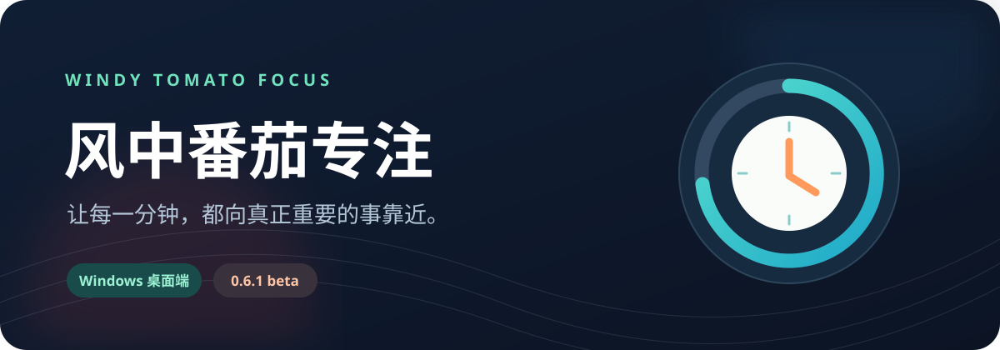
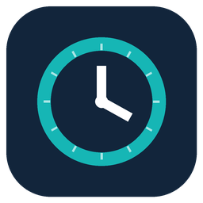
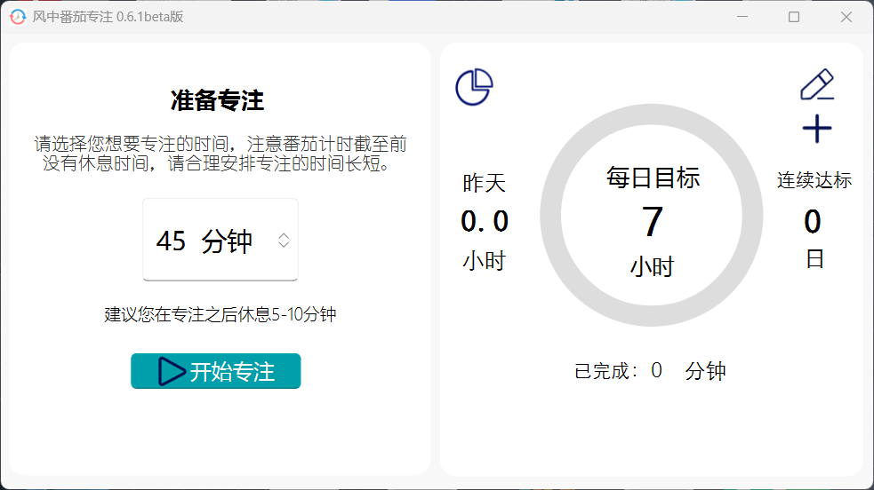
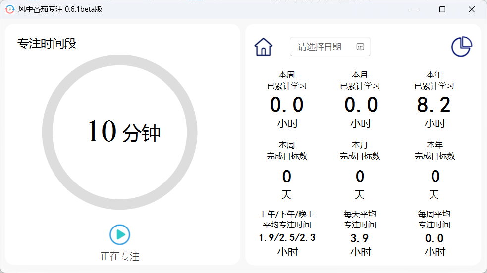

<p align="center">
  
</p>

<p align="center">
  
</p>

<h1 align="center">风中番茄专注</h1>

<p align="center">
  为 Windows 打造的桌面专注计时器。<br>
  从设定目标、进入心流，到回望每一天，让时间留下清晰的轨迹。
</p>

<p align="center">
  
  
  
  
</p>

---

## 界面预览

设置专注时长与每日目标：



进入专注后，查看计时与累计投入：



截图来自 0.6.1 beta 品牌版；公开源码运行时使用通用图标和系统提示音。截图与其中的品牌素材仅用于展示，授权边界见 [`RIGHTS.md`](RIGHTS.md)。

---

## 把注意力留给真正重要的事

| 专注当下 | 看见积累 | 自由掌控 |
| :--- | :--- | :--- |
| 设置分钟数，开始、暂停、继续或重置倒计时。 | 每日目标、进度、连续达标天数与历史记录。 | 托盘运行、完成通知、系统提示音与偏好设置。 |

- **专注计时**：自行选择时长，按需要暂停、继续或重置。
- **每日目标**：设定当天想投入的时间，查看进度和连续达标天数。
- **专注回顾**：查看指定日期、本周、本月和本年的累计专注时间与达标天数。
- **一周概览**：用进度条回看一周内每天的投入。
- **托盘常驻**：托盘图标显示专注状态，结束时可使用 Windows 通知和系统提示音。
- **本地保存**：记录写入本机 SQLite，设置写入本机 JSON。

当前源码对应 **0.6.1 beta**。历史更新见 [`shujuku/版本日志.txt`](shujuku/%E7%89%88%E6%9C%AC%E6%97%A5%E5%BF%97.txt)。本仓库只发布源码，不提供旧安装包。

## 运行源码

准备 Windows 和 Python 3，在项目目录执行：

```powershell
python -m venv .venv
.\.venv\Scripts\Activate.ps1
python -m pip install -r requirements.txt
python zhuchengxu.py
```

首次运行会在 `shujuku/` 下生成 `schedule.db` 和 `defaultdata.json`；它们存放个人记录与偏好，已被 `.gitignore` 排除。公开版使用 [`assets/public/`](assets/public/) 中的通用图标；专注完成时播放 Windows 系统提示音。作者原创的品牌图标与音乐不随源码发布。

## 项目结构

```text
.
├── zhuchengxu.py                  # 程序入口、计时流程与托盘交互
├── keshihua.py                    # 主窗口界面
├── demo.py                        # 设置与辅助对话框界面
├── jianku.py                      # SQLite 记录和设置读写
├── assets/public/                 # 公开版通用图标
├── assets/screenshots/            # 软件界面截图
├── tools/generate_public_assets.py # 通用图标生成脚本
├── shujuku/                       # 版本记录与程序内版权说明
├── LICENSE                        # 代码的 GPLv3 正文
└── RIGHTS.md                      # 代码、通用素材与原创品牌素材的边界
```

通用图标可以通过 `python -m pip install Pillow` 后运行 `python tools/generate_public_assets.py` 重新生成。

## 许可边界

| 内容 | 授权 |
| --- | --- |
| Python 源码、`tools/` 脚本、`assets/public/` 通用图标 | [GPL-3.0-only](LICENSE)。 |
| `assets/screenshots/` 软件界面截图 | 仅用于展示项目，不随源码按 GPL 授权；详见 [`RIGHTS.md`](RIGHTS.md)。 |
| “风中番茄专注”名称、作者原创品牌图标与音乐 | 权利由 LeonardoJay 保留；原始文件不包含在本仓库中，GPL 不授予使用这些品牌素材的许可。 |
| PyQt5、PyQt-Fluent-Widgets 等第三方依赖 | 由各自权利人的许可证单独约束。 |

详细边界见 [`RIGHTS.md`](RIGHTS.md)。**代码允许商用**，但分发与修改须遵守 GPLv3；本项目的原创品牌素材不随代码开放。使用通用图标重新打包、修改名称和标识，是二次发行时的清晰做法。

本项目的 GPL 授权只覆盖作者在上述范围内的内容；[PyQt-Fluent-Widgets 的官方许可页](https://pyqt-fluent-widgets.readthedocs.io/en/latest/license.html)另写有商业用途购买授权的说明。计划商业发行完整程序时，应先核对所用第三方组件的许可要求。

## 参与项目

欢迎通过 GitHub Issues 反馈问题与建议。提交修改前，请确认所贡献的内容可以在本仓库的 GPLv3 授权下发布，并勿提交个人数据库、旧安装包或不属于你的素材。

发布前的文件核对与自行推送步骤见 [`docs/RELEASE_PLAN.md`](docs/RELEASE_PLAN.md)。

---

<p align="center">由 LeonardoJay 创作 · 让专注变得可见</p>
